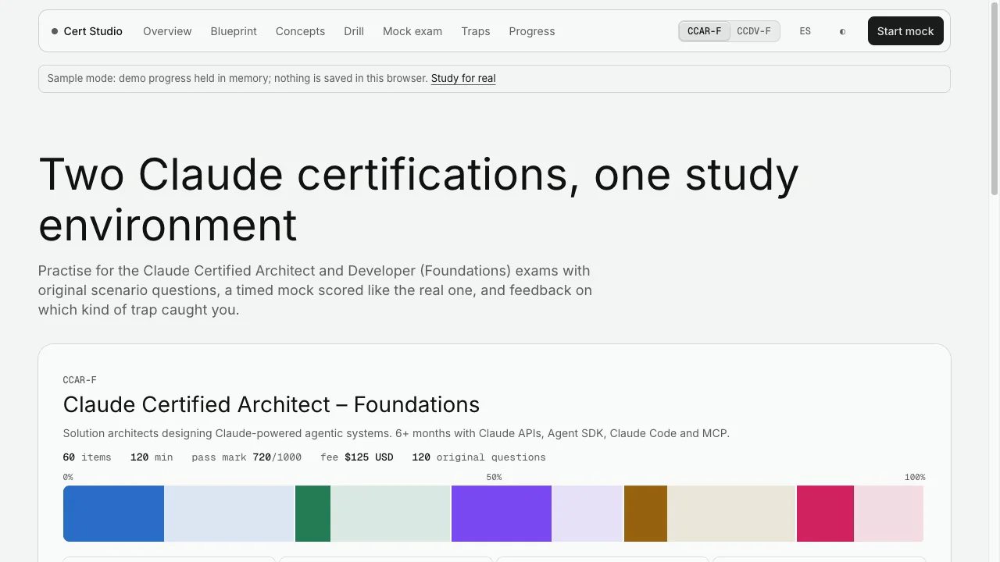
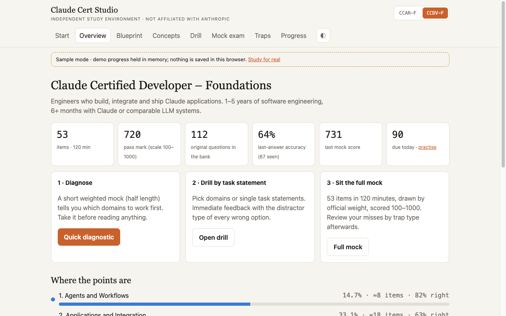
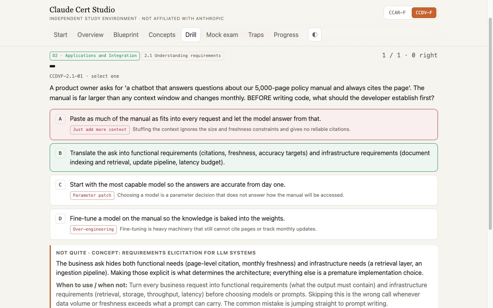
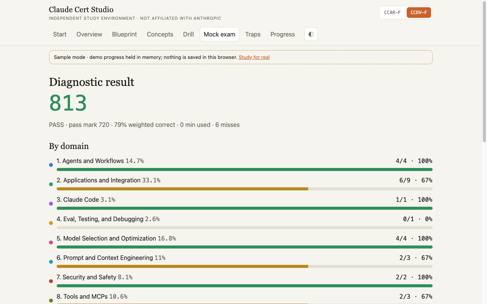
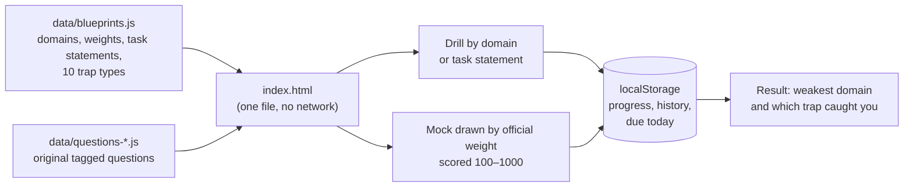

# Cert Studio — studying for the Claude certifications by building

[Español](README.md) · **Live app: https://cert.ichisieben.dev/**

    

A static study environment for Anthropic's **Claude Certified Architect – Foundations (CCAR-F)** and **Claude Certified Developer – Foundations (CCDV-F)** exams, plus the Spanish-language material I prepare with: one document per domain, seven labs on real projects and an 8-week plan.

> **Unofficial study aid. Not affiliated with or endorsed by Anthropic. All questions are original; none reproduces a real exam item (the real items are confidential).**



| Overview | Drill with the trap explained | Result by domain |
|---|---|---|
|  |  |  |

## How it works



- **No build, no server.** `app/index.html` opens from `file://`; the data ships as `.js` for exactly that reason.
- **Your progress is yours:** it lives in your browser's `localStorage` and is never sent anywhere. Export it to JSON from *Progress*.
- **Every wrong option is tagged** with one of ten distractor types (parameter patch, prompt-only fix, over-engineering, just add more context…). The result tells you which ones catch you, not only how many you missed.
- **The mock** draws questions by each domain's official weight (largest remainder), prefers questions that never appeared in your earlier mocks and scores `100 + 900 × weighted %` (pass at 720). The real scaling is not published: this is a linear approximation, a floor, not a promise.

## Run it

```bash
git clone https://github.com/IchiSieben/claude-cert-studio.git
cd claude-cert-studio
# open app/index.html in a browser. That's it.

# optional, for the tests:
npm ci && npx playwright install chromium
bash tools/verify.sh        # bank validator + 22 e2e tests
```

URL switches: `?sample=1` (demo progress in memory, your `localStorage` is never touched), `?lang=es` (navigation and start page in Spanish; questions stay in English, like the exam), `?cert=CCDV-F`, `?view=blueprint`.

## What is there, with numbers (2026-10-15)

| | |
|---|---|
| Original questions | **240**: 120 CCAR-F + 120 CCDV-F (18 + 15 select-two), spread by each domain's official weight |
| Review | Model-reviewed against the official docs; human sample pending (`app/data/REVIEW-SAMPLE.md`). The Sep 26 review removed 22 duplicates; on Oct 15 the bank was refilled by domain weight. |
| Trap types | 10, every wrong option carries one |
| Task statements covered | 30 (CCAR-F) + 25 (CCDV-F), from the official guides v1.0 |
| Tests | 22 Playwright e2e (`file://` plus a local server for offline use and layout shift) + a bank validator |
| Study documents | 8 domains, 7 labs, an 8-week plan, a per-objective checklist (Spanish) |

The bank reached 120 + 120; a review on 2026-09-26 against Anthropic's documentation removed 22 (19 duplicates) and corrected 65 with a source. **It was reviewed by a model, not yet by a human.** If you find a wrong question, open an issue with its id (`CCDVF-2.1-01`).

**Who can sit the real exams:** as of 2026-10-15 the [official FAQ](https://anthropic-partners.skilljar.com/page/faq-certifications) limits them to people at Claude Partner Network organizations, registering with a company email (18+).

## Honest limits

- Not official material, and it knows nothing about the real items. Written from the public guides v1.0 (July 2026); a v1.1 means rewriting the blueprint.
- The platform changed after the guide (model IDs, deprecated parameters, renamed tools). The bank teaches the guide's lesson in wording compatible with today's docs; the differences are listed in `03-practica/revision-banco-2026-09-26.md`.
- Progress does not travel between browsers: JSON export exists, import does not yet.
- The Spanish UI covers navigation and the start page; questions, explanations and the blueprint are in English.

## Licenses

Code (`app/index.html`, `tools/`, `tests/`): **Apache-2.0** (`LICENSE`). Questions and study documents: **CC BY 4.0**. "Claude" and "Anthropic" are trademarks of Anthropic, PBC, named only to identify the exams.

Made by [iC7](https://ichisieben.dev). Part of the Claude Code ecosystem with [claude-kit](https://github.com/IchiSieben/claude-kit) and [enjambre](https://github.com/IchiSieben/enjambre).
