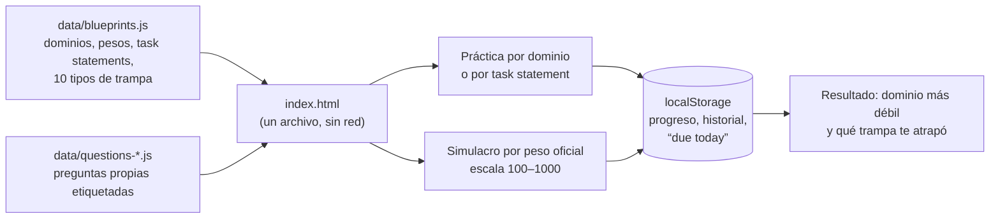

# Cert Studio — estudiar para las certificaciones de Claude construyendo

[English](README.en.md) · **App en línea: https://cert.ichisieben.dev/**

    

Un entorno de estudio estático para los exámenes **Claude Certified Architect – Foundations (CCAR-F)** y **Claude Certified Developer – Foundations (CCDV-F)** de Anthropic, más el material en español con el que lo preparo: un documento por dominio, siete labs sobre proyectos reales y un plan de 8 semanas.

> **Unofficial study aid. Not affiliated with or endorsed by Anthropic. All questions are original; none reproduces a real exam item (the real items are confidential).**
> Material de estudio no oficial. Sin relación con Anthropic ni respaldo suyo. Todas las preguntas son propias; ninguna reproduce un ítem real del examen.


| Resumen | Práctica con la trampa explicada | Resultado por dominio |
|---|---|---|
|  |  |  |

## Cómo funciona



- **Sin build ni servidor.** `app/index.html` se abre con `file://`; los datos van como `.js` justamente para eso.
- **El progreso es tuyo:** vive en el `localStorage` de tu navegador y no se envía a ninguna parte. Se exporta a JSON desde *Progress*.
- **Cada opción incorrecta está etiquetada** con uno de diez tipos de distractor (parche de parámetro, “solo con el prompt”, sobreingeniería, más contexto…). El resultado te dice cuáles te atrapan, no solo cuántas fallaste.
- **El simulacro** extrae preguntas por el peso oficial de cada dominio (resto mayor), da prioridad a las que nunca salieron en tus simulacros anteriores y puntúa `100 + 900 × % ponderado` (aprueba con 720). La escala real no es pública: esto es una aproximación lineal, un piso y no una promesa.

## Cómo correrlo

```bash
git clone https://github.com/IchiSieben/claude-cert-studio.git
cd claude-cert-studio
# abre app/index.html en el navegador. Eso es todo.

# opcional, para los tests:
npm ci && npx playwright install chromium
bash tools/verify.sh        # validador del banco + 16 tests e2e
```

Parámetros de URL: `?sample=1` (progreso de demostración en memoria, no toca tu `localStorage`), `?lang=es` (navegación y página de inicio en español; las preguntas siguen en inglés, como el examen), `?cert=CCDV-F`, `?view=blueprint`.

## Qué hay, con números (15-oct-2026)

| | |
|---|---|
| Preguntas originales | **218**: 106 CCAR-F + 112 CCDV-F (16 + 14 de “select two”) |
| Tipos de trampa | 10, cada opción incorrecta lleva uno |
| Task statements cubiertos | 30 (CCAR-F) + 25 (CCDV-F), de las guías oficiales v1.0 |
| Tests | 16 e2e con Playwright sobre `file://` + validador del banco |
| Documentos de estudio | 8 dominios, 7 labs, plan de 8 semanas, checklist por objetivo (en español) |

El banco llegó a 120 + 120 y la revisión del 26-sep-2026 contra la documentación de Anthropic eliminó 22 (19 duplicados) y corrigió 65 con fuente. **Lo revisó un modelo, todavía no una persona.** Si encuentras una pregunta mal, abre un issue con su id (`CCDVF-2.1-01`).

## Material de estudio (español)

| Carpeta | Qué contiene |
|---|---|
| `00-examen/` | Ficha del examen, blueprint CCDV-F con objetivos codificados (`D2.T3.h`), estrategia, blueprint CCAR-F |
| `01-dominios/` | Un documento por dominio, ordenados por peso: conceptos con el vocabulario del examen, tablas de decisión, “aplícalo en tus proyectos”, autoevaluación |
| `02-plan/` | Plan de 8 semanas (con track paralelo CCAR-F) y checklist por objetivo |
| `03-practica/` | 50 preguntas comentadas, flashcards, glosario, revisión del banco |
| `04-bibliografia/` | Fuentes oficiales, blog de ingeniería, papers |
| `05-labs/` | Siete labs semanales para hacer con Claude Code |
| `docs/` | Arquitectura, conceptos que enseña (`ESTUDIO.md`), capturas |

**Quién puede rendir los exámenes reales:** al 15-oct-2026, la [FAQ oficial](https://anthropic-partners.skilljar.com/page/faq-certifications) los limita a personas de organizaciones del Claude Partner Network, con correo corporativo (18+).

## Límites honestos

- No es material oficial ni sabe nada de los ítems reales. Está escrito desde las guías públicas v1.0 (julio 2026); si sale una v1.1, el blueprint se rehace.
- La plataforma cambió después de la guía (IDs de modelo, parámetros deprecados, herramientas renombradas). El banco enseña la lección de la guía con redacción compatible con la documentación actual; las diferencias están en `03-practica/revision-banco-2026-09-26.md`.
- El progreso no viaja entre navegadores: hay exportación a JSON, todavía no importación.
- La interfaz en español cubre la navegación y la página de inicio; preguntas, explicaciones y blueprint están en inglés.

## Licencias

Código (`app/index.html`, `tools/`, `tests/`): **Apache-2.0** (`LICENSE`). Preguntas y documentos de estudio: **CC BY 4.0**. “Claude” y “Anthropic” son marcas de Anthropic, PBC; se nombran solo para identificar los exámenes.

Hecho por [iC7](https://ichisieben.dev). Parte del ecosistema Claude Code junto a [claude-kit](https://github.com/IchiSieben/claude-kit) y [enjambre](https://github.com/IchiSieben/enjambre).
